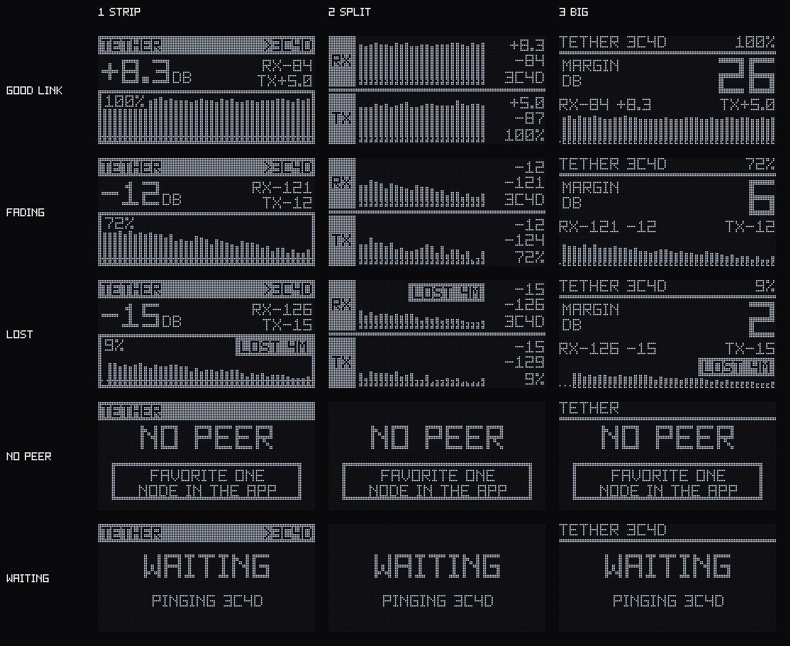
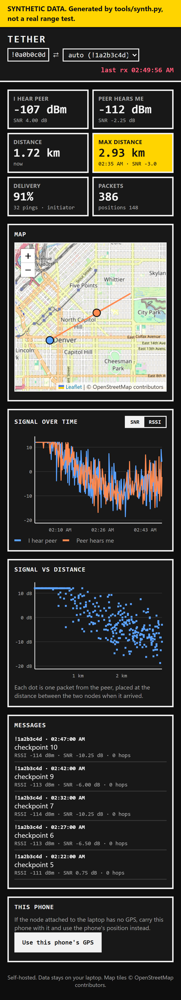

# TETHER

A Meshtastic firmware add-on module for the **Heltec WiFi LoRa 32 V4** (ESP32-S3R2, SX1262 + front-end module), plus a laptop logger and a mobile web app.

> **Status: firmware for Phases 1-3 written and compiling, laptop tools working on synthetic data. Nothing has run on
> a board yet.** The `heltec-v4` firmware with TETHER builds without warnings; the hardware-independent logic passes host
> unit tests; the dashboard passes a real-browser test. See [PLANNED_FEATURES.md](PLANNED_FEATURES.md) for exactly what is
> tested and how. OLED look: layout 1 (STRIP), see [docs/OLED.md](docs/OLED.md).
> Do not assume any feature works until it is marked tested in [PLANNED_FEATURES.md](PLANNED_FEATURES.md).

## What it adds
1. **Live link quality** between a fixed pair of nodes: continuous two-way RSSI/SNR, history, and fade margin, shown on the device and exportable.
2. **Better power tracking**: smoothed battery readings, TX voltage sag, charge/solar detection, runtime estimate, optional true mA/mAh via an external INA219/226/260 on I2C.
3. **Laptop logger and dashboard** ([`tools/`](tools/README.md), tested on synthetic data only): `logger.py` saves everything a connected node hears (messages, GPS, signal) to a local SQLite database with timestamps and can send messages from the terminal. `dashboard.py` shows it live in a browser: node map, SNR over time, signal vs. distance, max distance reached, and message history with signal info. This turns a range test into real graphs and numbers instead of guesses.
4. **Mobile web app** (built into the dashboard, not yet tried on a phone): the dashboard as a mobile-first PWA you can add to an iPhone Home Screen, self-hosted over LAN or Tailscale. No native iOS app.

## What it looks like
Both images below are rendered from **synthetic** data (`tools/synth.py`, labelled as such), not from a real test.

| OLED layouts (1 STRIP is the chosen one: [docs/OLED.md](docs/OLED.md)) | Dashboard on a phone ([tools/](tools/README.md)) |
|---|---|
|  |  |

## Hardware notes
- Target env: `heltec-v4` (OLED, SSD1306-compatible). `heltec-v4-tft` exists upstream but is not targeted.
- Battery ADC: `BATTERY_PIN` 1, enable via `ADC_CTRL` 37. **No current sensor on the board**; real current needs an external INA part.
- OLED env I2C: SDA 17 / SCL 18, second bus 4 / 3. Only the TFT env defines a buzzer (GPIO 6); the OLED env does not. Buzzer pin is deferred, so the proximity tone stays compiled out for now.
- V4.2 uses a GC1109 front end, V4.3 a KCT8103L. RX behaviour differs, so absolute RSSI is not comparable across revisions or against V3. Use relative changes on the same hardware.

## How it hooks into Meshtastic
- Lives in its own folder under `src/modules/optional/` via the `OPTIONAL_MODULES_SETUP` hook. No core files patched, so upstream updates stay easy.
- Modelled on `RangeTestModule` (`SinglePortModule` + `OSThread`, hop_limit 0, checks `airTime->isTxAllowedChannelUtil()` before sending).
- Uses `PRIVATE_APP` (port 256). The stock phone app will **not** display this data; output goes to OLED, serial and MQTT.
- Reuses existing Meshtastic pieces: per-packet `rx_rssi`/`rx_snr`, the LiPo OCV curve in `Power.h`, and the INA219/226/260 telemetry sensors.

## Repo layout
```
module/Tether/   module source, copied into a firmware checkout
tests/host/      unit tests for the hardware-independent code (run on a PC)
tools/           laptop logger, dashboard/PWA, synthetic data generator (see tools/README.md)
docs/            design notes, open decisions
scripts/         build_firmware.py, install_module.py, host test runner, OLED font/preview generators
PLANNED_FEATURES.md
```
This is a standalone repo that copies the module into a Meshtastic firmware checkout. It is **not** a fork.

## Getting started
**One command** (clones the pinned Meshtastic firmware if needed, installs the module, builds, optionally flashes):
```sh
python -m pip install platformio
python scripts/build_firmware.py                       # build
python scripts/build_firmware.py --upload --port COM5  # build + flash one board
```
On Windows run it from PowerShell, not Git Bash. Manual steps and the Windows gotchas: [docs/BUILD.md](docs/BUILD.md).
First time on real boards: [docs/HARDWARE_TEST.md](docs/HARDWARE_TEST.md).

Tests without a board: `python scripts/run_host_tests.py` (C++) and `python -m unittest discover -s tools/tests` (laptop
tools). GitHub Actions runs both on every push; the firmware build can be started by hand from the Actions tab.

## Using it (Phase 1, untested on hardware)
1. Flash both boards with the TETHER build. Same region, channel and preset on both.
2. In the Meshtastic app on each board, **favorite the other board, and only that one**. Exactly one favorite = the
   peer. (Or build with `-DTETHER_PEER_NODENUM=0x........`.)
3. Watch the USB serial log for `TETHER` lines: the board with the lower node number sends pings, the other replies.
   Expect the first ping about 30 s after boot, then one per interval (about 12 s on LongFast).
4. `device.rebroadcast_mode` must not be `CORE_PORTNUMS_ONLY`, because that mode drops port 256.

## Principles
- MVP (phase 1) working end to end before polishing later phases. Architecture and data flow first, UI last.
- Self-hosted only, no paid cloud services.
- Respect airtime and duty-cycle limits; never send traffic that ignores channel utilization.
- Nothing is claimed to work unless it was built and tested.

## License
GPL-3.0 (links into Meshtastic). See [LICENSE](LICENSE).
