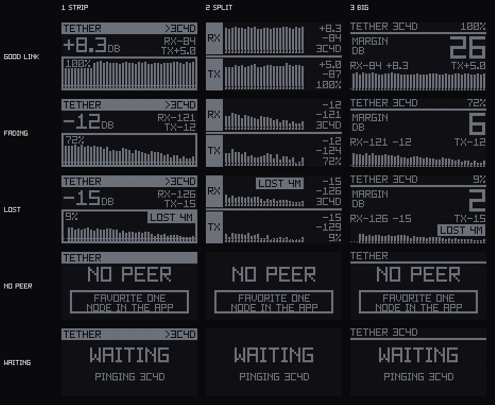

# OLED screen

**Chosen look: layout 1, STRIP** (decided 2026-11-06). It is the default build. Layouts 2 and 3 stay in the code as
alternatives you can switch to with one flag:

```sh
python scripts/build_firmware.py --layout 2     # or -DTETHER_OLED_LAYOUT=2 in build_flags
```
`-DTETHER_OLED=0` leaves the TETHER page out entirely.

These are real renders: the same C++ drawing code the firmware runs, rendered on a PC
(`python scripts/render_oled_previews.py`) from **synthetic** link scenarios, at 128×64 with the pixel grid shown.
They have not been seen on a physical OLED yet.



| | 1 STRIP | 2 SPLIT | 3 BIG |
|---|---|---|---|
| Idea | Header bar, big "how I hear the peer" SNR, full-width scrolling bar graph | Two stacked panels: RX (I hear peer) and TX (peer hears me), each with its own graph | One huge number: fade margin in dB, readable at arm's length |
| Best for | General use, watching the trend | Seeing whether a link is lopsided (one direction worse) | Walking/fox-hunting, glance value |
| Graph | 41 bars, fixed −20…+12 dB scale, dotted line at the demodulation floor | 25 bars per panel, same scale | 42 bars, short |
| Also shows | RSSI, peer's SNR of me, delivery %, LOST badge | RSSI per direction, peer id, delivery % | RSSI + SNR line, peer's SNR of me, delivery %, LOST badge |

Shared details:
- **Font**: own 5×7 squared bitmap font (`scripts/gen_tether_font.py`, ASCII art, easy to edit), scaled 2× or 3× for big
  numbers. Zero is slashed so it differs from O.
- **Labels**: `RX` = how this board hears the peer, `TX` = how the peer hears this board (from TETHER reports).
  `>` = this board sends the pings, `<` = it replies.
- **States**: `NO PEER` (with the favorite hint), `NO REGION`, `WAITING` (peer set, nothing heard yet), and a `LOST`
  badge after 90 s without a packet from the peer.
- Fixed vertical scale on purpose, so bar height means the same thing every time you look.

Single frames, 4× size: [strip](oled/strip-good.png) · [split](oled/split-good.png) · [big](oled/big-good.png), plus
`-fading`, `-lost`, `-nopeer`, `-waiting` variants in [docs/oled/](oled/).

Not done yet: the proximity tone (no buzzer pin chosen), screen brightness on low battery, and any input handling
(buttons). The page is one frame in Meshtastic's normal screen carousel.
