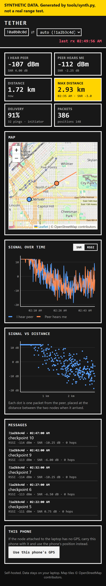

# TETHER laptop tools

Record everything your node hears, then watch it live in a browser or on your phone.

| Tool | What it does |
|---|---|
| `logger.py` | Connects to a node over USB serial or TCP, saves every packet (messages, positions, signal) and every `TETHER` log line to SQLite. Type in the terminal to send messages. Also replays datasets and exports InfluxDB line protocol. |
| `dashboard.py` | Serves the live dashboard: map, signal over time (both directions), signal vs distance, max distance, delivery rate, message history. Mobile-first, installable as a Home Screen app (PWA). |
| `synth.py` | Generates a **synthetic** walk-away range test, so all of this can be tried without hardware. |

Python 3.9+. The dashboard and replay need only the standard library; live logging needs `pip install -r tools/requirements.txt`.



## Try it without hardware (synthetic data)
```sh
python tools/synth.py --out synth.jsonl
python tools/logger.py --replay synth.jsonl --db demo.db --speed 20   # replays 20x real time; or omit --speed for instant
python tools/dashboard.py --db demo.db                                # open http://127.0.0.1:8080
```
Everything replayed from `synth.py` is marked synthetic in the database, and the dashboard shows a yellow banner. It is a
link model, not a measurement. Never present it as range-test results.

## Real range test
1. Plug the base node into the laptop. On it, forward debug logs to the API so the logger sees `TETHER` lines:
   `meshtastic --set security.debug_log_api_enabled true`
2. Start logging (one database per test is tidy):
   `python tools/logger.py --port COM5 --db 2026-11-07-park.db` (Linux/macOS: `/dev/ttyUSB0`, `/dev/cu.usbserial-…`; omit
   `--port` to auto-detect; `--host 192.168.x.x` for a node on WiFi)
3. In another terminal: `python tools/dashboard.py --db 2026-11-07-park.db --host 0.0.0.0`
4. The peer needs a position source: GPS with position sharing on. The base node's position comes from its own GPS,
   from **this phone** (dashboard button), or a fixed point: `python tools/logger.py --db … --base 39.7392,-104.9903`.
5. Walk. "Max distance" is the furthest distance at which a packet from the peer was actually received.

Terminal commands while logging: type text + Enter to broadcast, `/dm !1a2b3c4d text` to DM, `/quit` to stop.

## Phone (PWA)
- Same Wi-Fi: `--host 0.0.0.0`, then open `http://<laptop-ip>:8080` on the phone.
- Anywhere, privately: [Tailscale](https://tailscale.com) on laptop and phone, then `tailscale serve --bg 8080` and open
  the `https://<laptop>.<tailnet>.ts.net` address. This is also what makes **phone GPS** work: iOS only gives web
  pages your location over HTTPS. You can also pass `--cert`/`--key` with your own certificate.
- iPhone: Share → **Add to Home Screen** for a full-screen app with an icon. The app shell is cached, so it opens even if
  the laptop is briefly unreachable. Data always comes live from the laptop.

Security: there is no login. Anyone who can reach the port can read the data and post positions. Keep it on
`127.0.0.1` (default), your own LAN, or your tailnet.

## Export to InfluxDB / Grafana (self-hosted)
```sh
python tools/logger.py --db rangetest.db --export-lp rangetest.lp
influx write --bucket tether --file rangetest.lp        # InfluxDB 2.x CLI, your own server
```
Measurements: `tether_rx`, `tether_rpt`, `tether_tx`, `tether_stats`, `tether_skip`, … (tags `node`, `peer`, `kind`) and
`mesh_rx` for every received packet (tags `from`, `port`, `direct`).

## What the data means
- **I hear peer**: RSSI/SNR of packets from the peer, measured by the node attached to the laptop. Only packets heard
  directly count (a relayed copy carries the relay's signal, not the peer's).
- **Peer hears me**: from TETHER replies and reports, the peer's measurement of our packets. Needs TETHER firmware on both nodes.
- **Delivery**: share of the last 32 TETHER pings that got a reply (initiator), or of pings heard (responder).
- Absolute RSSI is not comparable between board revisions (V4.2 / V4.3 / V3). Compare SNR, or RSSI trends on the same boards.

## Tests
```sh
python -m unittest discover -s tools/tests -v          # 20 tests, standard library only
python tools/tests/e2e_dashboard.py --shots docs/screenshots   # real browser (Playwright + Edge/Chrome), synthetic data
```
